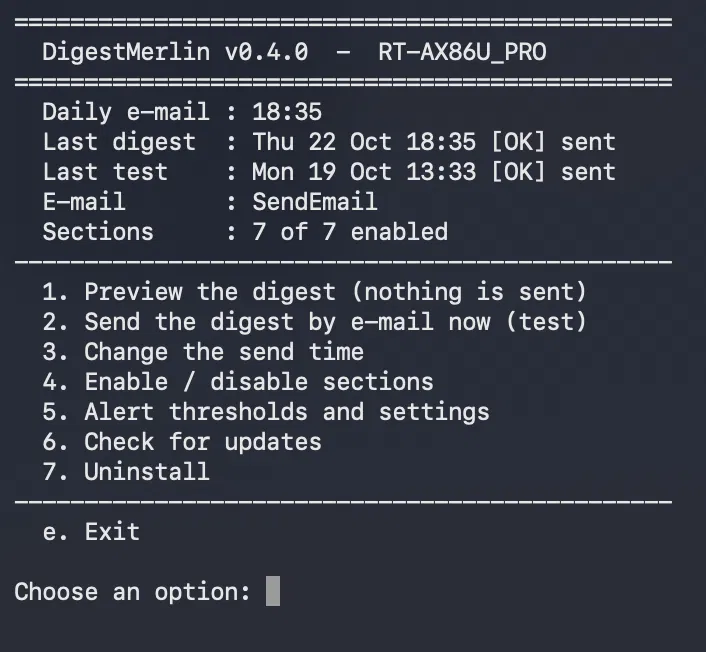

# DigestMerlin

**One daily e-mail with the health of your Asuswrt-Merlin router and its add-ons.**

Each add-on (Skynet, Diversion, VPNMON-R3, spdMerlin, BACKUPMON, MerlinAU...) watches its own corner and
sends its own alerts, or none at all. DigestMerlin reads them all once a day and sends a single,
short summary: what is fine, and what needs a look.

- **Read-only**: it reports, it never changes your router's configuration.
- **Adapts to your router**: a section whose add-on is not installed is skipped.
- **Never silent**: a section that fails or hangs is shown as unavailable (it never blocks the
  e-mail), sending is tried up to 3 times, and an e-mail that could not be sent is reported in the next one.
- **Uses the e-mail set up in amtm**, sent by Martinski's SendEmail add-on: no extra password to store.
- **Modular**: one small script per section. Adding a section = dropping a file.

## Example

```
Subject: [OK] Daily digest RT-AX86U_PRO - 2026-10-12

=== SUMMARY ===
All green.

=== SKYNET FIREWALL ===
Blacklist: 42470 IPs | 2779 ranges
List refresh: Mon 12 Oct 11:25 (11h11m ago, daily)
Download failures (24h): 0
Blocked inbound (24h): 0 | outbound: 0

=== DIVERSION (ad blocking) ===
Diversion 6.1.1: enabled | ad blocking on
Blocking list: 56735 domains (Standard) - loaded by dnsmasq
List update: Thu 08 Oct 02:10 (4d20h ago, weekly on Thursday)
Ads blocked: 8,896 this week (counted Mon 12 Oct 17:20)

=== VPN ===
WGC1 (FR server): UP | 203.0.113.10:51820 | handshake <1m ago
WGC2 (FR server): UP | 203.0.113.20:51820 | handshake 1m ago
VPNMON-R3: running
Tunnel restarts by VPNMON-R3 (24h): 0

=== SPEED TESTS (spdMerlin) ===
WAN: 878 down / 685 up Mbps, 2 ms (4h21m ago)
WGVPN1: 600 down / 407 up Mbps, 4 ms (4h20m ago)

=== BACKUPS (BACKUPMON) ===
Last NVRAM backup: Mon 12 Oct 04:00 (18h36m ago)
Last JFFS backup: Mon 12 Oct 04:00 (18h36m ago)
Errors (24h): 0

=== NEW DEVICES ===
No new device (12 leased now)

=== SYSTEM ===
Firmware: 3006.102.9_0 (RT-AX86U_PRO)
MerlinAU: no pending update
Last boot: Sun 11 Oct 03:03 (up 1d19h)
WAN link drops (24h): 0
Load: 1.18 1.16 1.15 | memory 61% used | swap 0 MB used | CPU 64C
Storage /jffs: 22% used
Storage Entware (USB): 5% used
Scripts writable by anyone: 0

=== ALERTS ===
None

Generated 2026-10-12 22:36 - covers the last 24h
Sections: 7 OK
DigestMerlin v0.5.0
```

When something is wrong, the subject becomes `[ATTENTION]` and the ALERTS section says what, e.g.
`- VPN: WGC2 has had no handshake for 2h10m - tunnel probably not passing traffic`.

## Sections

| Section | Needs | Reports | Alerts when |
|---|---|---|---|
| Skynet | Skynet (v9 for traffic counts) | blacklist size, last list refresh, download failures, blocked inbound/outbound traffic | blacklist not loaded or halved since the last digest, lists not refreshed on schedule, download failures, log collection stalled |
| Diversion | Diversion | version and status, blocking list size and whether dnsmasq loads it, last list update, ads blocked this week (Diversion's daily count; right after its weekly reset, last week's total) | Diversion disabled or ad blocking off, list missing, empty, not loaded or halved since the last digest, list not updated on its weekly schedule, Diversion's files on the USB drive missing |
| VPN | WireGuard and/or OpenVPN clients; VPNMON-R3 optional | each enabled WireGuard client (endpoint, last handshake), each OpenVPN client that is running or set to start with the WAN, VPNMON-R3 restarts (with the 7-day count when there were 3 or more) | interface down, no handshake for 10 min (setting) or never, OpenVPN error, still connecting, connected without its interface, or stopped while set to start with WAN, VPNMON-R3 not running |
| Speed tests | spdMerlin | latest result per interface; **To watch** when a download or upload is 30% or more below its usual best at the same time of day (see below) | no new result for 25 h (interfaces excluded from automatic tests in spdMerlin are shown, never alerted), failed tests |
| Backups | BACKUPMON | last NVRAM / JFFS / EXT Drive (USB) backup | no BACKUPMON log or no completed NVRAM backup, last NVRAM backup older than 26 h, BACKUPMON errors |
| New devices | DHCP (dnsmasq) | MAC addresses never seen before | a new device joined the LAN |
| System | — (Entware `findutils` for the permission check) | firmware (and pending MerlinAU update), uptime, WAN link drops (with the 7-day count when there were 2 or more), load, memory, temperature, storage, files writable by anyone in /jffs/scripts, /jffs/addons and /jffs/configs | firmware changed, WAN link dropped (outside a planned window, see Settings), disk almost full, a script writable by anyone, CPU temperature (optional), no reboot for too long (optional) |

**To watch.** Some changes are worth knowing about without being a problem yet. When a speed test
result is 30% or more below the usual best of that interface **at the same time of day**, the digest
adds a line under the result and lists it under the verdict in SUMMARY, for example:

```
=== SUMMARY ===
All green.
To watch: WGVPN1 upload -54% vs its best at this time of day
```

It is not an alert: the digest stays `[OK]`. The usual best is the 3rd best result of the last
30 days within 90 minutes of the same time of day, so one lucky result does not become the
reference, and evening congestion is compared with other evenings, never with mornings.
A VPN tunnel is only compared with its results **on the same VPN server**: when VPNMON-R3 or
you move it to another server, its comparisons start again (the change itself is shown in the
VPN section), so a slower new server is not reported as a slow tunnel every evening.
spdMerlin keeps only its last 10 results, so DigestMerlin keeps its own 30-day history of them
(`state/speed_<interface>.hist`, about 120 lines each). Comparisons start once 7 results of the
same time of day are known, i.e. after about a week.

## Requirements

- Asuswrt-Merlin with JFFS custom scripts enabled (tested on 3006; 3004 should work but is untested).
- E-mail configured in **amtm** (`amtm` → `em`).
- **SendEmail**, Martinski's e-mail add-on, installed from amtm (`amtm` → `se`). It sends the digest
  and keeps Martinski's Custom Email Library (`CustomEMailFunctions.lib.sh`) up to date.
  If SendEmail is not installed but the library is already on the router (installed by another
  add-on), DigestMerlin uses the library directly and the menu recommends installing SendEmail.
- Entware is recommended but not required. Its `find` (`opkg install findutils`) is needed for the
  check of files writable by anyone (without it, the digest says "not checked"), and its `timeout`
  is used to stop a hanging nvram read (without it, DigestMerlin stops the read itself after 5 s).

Tested on an RT-AX86U Pro with Merlin 3006.102.9, Skynet 9.0.7, Diversion 6.1.2, VPNMON-R3, spdMerlin,
BACKUPMON and MerlinAU 1.7.1, with WireGuard clients. Also reported working on an RT-BE88U and an RT-AX86U. The OpenVPN checks have
only been tested on a simulated router so far: reports from OpenVPN users and other models are welcome.

## Install / update

```sh
curl -fsSL https://raw.githubusercontent.com/PierreAlex-TiTi/DigestMerlin/main/install.sh -o /tmp/dm-install.sh && sh /tmp/dm-install.sh
```

Then open the menu (option 1 previews the digest without sending anything):

```sh
sh /jffs/scripts/digestmerlin.sh
```

From your next SSH login, typing `digestmerlin` is enough: DigestMerlin adds one line, marked
`# DigestMerlin`, to `/jffs/configs/profile.add`, the file the firmware reads at each login (other
add-ons put their shortcuts there too).

If you use IOCMON, it reports DigestMerlin's files, its services-start line and its cron job
after installing or updating: this is expected.

To update later: menu option 6, `sh /jffs/scripts/digestmerlin.sh update`, or the install command
again. Your settings, history and schedule are always kept.

## Usage

Open the menu:

```sh
digestmerlin
```

(or `sh /jffs/scripts/digestmerlin.sh`, e.g. in your first session after installing).



The main actions also exist as commands - handy for scripts, and `section` helps to troubleshoot one section:

```sh
sh /jffs/scripts/digestmerlin.sh preview          # build and print the digest (no e-mail)
sh /jffs/scripts/digestmerlin.sh run              # build and e-mail it
sh /jffs/scripts/digestmerlin.sh section vpn      # run a single section
sh /jffs/scripts/digestmerlin.sh install 18:30    # e-mail it every day at 18:30
sh /jffs/scripts/digestmerlin.sh unschedule       # stop the daily e-mail (files kept)
sh /jffs/scripts/digestmerlin.sh update           # update to the latest version
sh /jffs/scripts/digestmerlin.sh uninstall        # remove DigestMerlin completely
```

`install` adds a cron job and one line, marked `# DigestMerlin`, to `/jffs/scripts/services-start`
so the schedule survives reboots. `unschedule` removes both.

The first `run` records the devices currently on your LAN. Devices that were offline at
that moment (a TV, a printer, a console...) are reported once when they reconnect during
the following days: a good way to review everything connected to your network.
After that, only devices never seen before are reported.

## If no e-mail arrives

1. Open the menu and look at the `E-mail` line of the header:
   - `NOT set up`: exit the menu, type `amtm`, choose `em` and enter your e-mail settings
     (server, address, password), then choose `se` to install SendEmail;
   - `library only`: e-mail works, but install SendEmail (`amtm` → `se`) to keep it up to date;
   - `SendEmail`: all set.

   Sent through SendEmail, the digest shows **DigestMerlin** as the sender name; through the library
   alone, it shows the router's login user name. Keep that in mind for mail filters.
2. Back in the DigestMerlin menu, use option 2 to send a test digest. If it says `NOT sent`,
   check the e-mail settings in amtm again (an expired app password is a common cause).
   SendEmail can also send its own test: `/jffs/scripts/SendEmail -test`.
3. Check that the daily e-mail is scheduled (header: `Daily e-mail : HH:MM`, otherwise option 3).

A digest that could not be sent is reported in the ALERTS of the next one, with its own alerts.

## Settings

Nothing needs to be configured: the defaults below are used until you change them.
The easiest way to change them is the menu: option 4 for the sections, option 5 for the rest.

| Setting | Menu | Default | What it does |
|---|---|---|---|
| `DISABLED_SECTIONS` | 4 | (none) | Sections left out of the digest, e.g. `"devices speedtest"`. |
| `WG_HANDSHAKE_MAX` | 5.1 | 600 | Seconds without a WireGuard handshake before a tunnel is reported as not passing traffic. |
| `SPEEDTEST_MAX_AGE_H` | 5.2 | 25 | Hours without a new spdMerlin result before alerting (a daily test plus one hour of margin). |
| `BACKUP_MAX_AGE_H` | 5.3 | 26 | Hours since the last BACKUPMON NVRAM backup before alerting. |
| `DISK_ALERT_PCT` | 5.4 | 90 | Storage use (%) of `/jffs` or the USB drive that raises an alert. |
| `CPU_TEMP_ALERT` | 5.5 | off | CPU temperature (C) that raises an alert. See below. |
| `REBOOT_MAX_DAYS` | 5.6 | off | Alert when the router has not rebooted for this many days. See below. |
| `DEVICES_IGNORE_PRIVATE_MAC` | 5.7 | 0 | `1` = do not report devices using a random "private" MAC address (phones, laptops). |
| `SUBJECT_PREFIX` | 5.8 | (none) | Text added in front of the e-mail subject. See below. |
| `UPDATE_CHECK` | 5.9 | 1 | `1` = the digest tells you when a new DigestMerlin version is on GitHub. See below. |
| `WAN_PLANNED` | 5.10 | (none) | A window when WAN drops are expected, e.g. `"Sun 03:00-03:10"`: they are shown, but raise no alert. See below. |

**Why two alerts are off by default.** The temperature is shown in the SYSTEM section when the router reports it (no temperature shown means no temperature alert is possible),
but what is normal depends on the model: around 65C on some routers, 80C or more on others. A fixed
limit would send useless alerts to many users, so you choose it: about 10C above your usual value
is a good start. Same for reboots: many routers are never rebooted on purpose. If yours reboots on a
schedule, set the limit just above it (e.g. `8` for a weekly reboot) and the digest tells you when
a scheduled reboot did not happen.

**Subject prefix.** With `[Home]`, the subject becomes `[Home] [OK] Daily digest RT-AX86U_PRO - ...`.
Useful when you receive digests from several routers, or to sort them with an e-mail rule.
In the menu, type `none` to remove it.

**Update check.** Each digest reads the version of DigestMerlin published on GitHub
(the same check as menu option 6). When a newer one exists, a line at the end of the e-mail says so;
it is not an alert. Nothing is sent: it only reads a public file. If GitHub does not answer, the
line is simply left out. `0` turns the check off.

**Planned WAN drops.** If your modem or ONT is rebooted on a schedule, its WAN drops are real but
expected. Set the window (a day - `Mon`...`Sun`, or `daily` - and a time range, router time) and the
drops that start in it are shown apart, without an alert:

```
WAN link drops (24h): 0 | planned (Sun 03:00-03:10): 2 (last Sun 25 Oct 03:03, longest 56s)
```

A drop outside the window is still an alert, and so is a link that does not come back up. Planned
drops are not counted in the 7-day total. In the menu, type `none` to remove the window.

**Editing by hand.** The settings live in `/jffs/addons/digestmerlin.d/digestmerlin.conf`
(created by the menu on the first change). Without the menu, create it from the sample and edit it:

```sh
cp /jffs/addons/digestmerlin.d/digestmerlin.conf.sample /jffs/addons/digestmerlin.d/digestmerlin.conf
nano /jffs/addons/digestmerlin.d/digestmerlin.conf    # or vi (nano: opkg install nano)
```

Number settings must be plain numbers (`90`, not `90%`) within the limits the menu shows: any other value
is ignored, its default is used and the digest says so.
Check the effect with menu option 1 (or `sh /jffs/scripts/digestmerlin.sh preview`).
Your settings are kept when you update DigestMerlin.

## Writing a section

A section is a shell script in `/jffs/addons/digestmerlin.d/sections/`, named `NN-name.sh`
(NN sets the order). Line 2 gives its title:

```sh
#!/bin/sh
# TITLE: MY SECTION
. "$(dirname "$0")/lib.sh"

[ -f /jffs/scripts/mytool.sh ] || exit 3      # tool not installed: section skipped

echo "Something: OK"                           # text shown in the e-mail
add_alert "MyTool: something needs a look"     # goes to the ALERTS list
exit 0
```

A section must print at least one line: one that prints nothing is shown as unavailable.

Updates never remove your own sections. Give yours a name of its own (e.g. `90-my-tailscale.sh`):
a file with exactly the same name as one shipped with DigestMerlin would be replaced by it.

`lib.sh` provides `read_logs` and `in_window` (syslog lines of the last 24 h), `nv` (nvram read,
stopped after 5 s), `fmt_age`, `fmt_time`, and `state_get` / `state_set` to remember a value between runs.

## Files

```
/jffs/scripts/digestmerlin.sh                main script
/jffs/addons/digestmerlin.d/sections/        one script per section
/jffs/addons/digestmerlin.d/digestmerlin.conf    your settings (optional)
/jffs/addons/digestmerlin.d/state/           values remembered between runs
```

## Uninstall

Menu option 7, or:

```sh
sh /jffs/scripts/digestmerlin.sh uninstall
```

Both ask first, then remove everything: schedule, `digestmerlin` shortcut, settings, history and files - including any section
you added in `/jffs/addons/digestmerlin.d/sections/` (copy it elsewhere first if you want to keep it).

## License

GPL-3.0. Thanks to the authors of the add-ons DigestMerlin reads, to Martinski for SendEmail and the
Custom Email Library, and to thelonelycoder for amtm.
